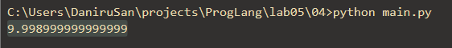
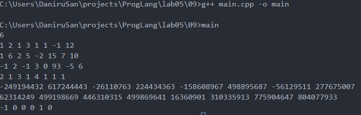

# Языки программирования
## Лабораторная работа 5

### Задание 1 
*Перевод чисел $\frac{13}{32}$ и $\frac{5}{11}$ в двоичную форму* 

**Первое число это $\frac{13}{32}$**
* *Так как это конечная двоичная дробь, то можно разложить на простые дроби, у которых числитель равен 1*
* *$\frac{13}{32} = \frac{1}{4} + \frac{1}{8} + \frac{1}{32}$*
* *$0.01101_2 = 0\cdot\frac{1}{2} + 1\cdot\frac{1}{4} + 1\cdot\frac{1}{8} + 0\cdot\frac{1}{16} + 1\cdot\frac{1}{32} = \frac{13}{32}$*
* *$\frac{13}{32} = 0.01101$*

**Второе число это $\frac{5}{11}$**
* *Умножаем дробную часть на 2 и записываем целые части:*
* *$2\cdot\frac{5}{11} = \frac{10}{11}$ (0)*

* *$2\cdot\frac{10}{11} = \frac{20}{11}$ (1)*

* *$2\cdot\frac{9}{11} = \frac{18}{11}$ (1)*

* *$2\cdot\frac{7}{11} = \frac{14}{11}$ (1)*

* *$2\cdot\frac{3}{11} = \frac{6}{11}$ (0)*

* *$2\cdot\frac{6}{11} = \frac{12}{11}$ (1)*

* *$2\cdot\frac{1}{11} = \frac{2}{11}$ (0)*

* *$2\cdot\frac{2}{11} = \frac{4}{11}$ (0)*

* *$2\cdot\frac{4}{11} = \frac{8}{11}$ (0)*

* *$2\cdot\frac{8}{11} = \frac{16}{11}$ (1)*

* *Остаток $\frac{5}{11}$ повторился, значит период найден.*

* *$\frac{5}{11}$ = 0.(0111010001)*

### Задание 2 
**Перевод числа 113.7 в двоичное число типа double**


**Формат double это 1 бит для знака, 11 бит - порядок, 52 бита - мантиса, смещение - 1023**


**Знак положительный, значит знаковый бит будет 0**


**Переводим целую часть числа в двоичный код**
* *113 / 2 = 56 (1)*
* *56 / 2 = 28 (0)*
* *28 / 2 = 14 (0)*
* *14 / 2 = 7 (0)*
* *7 / 2 = 3 (1)*
* *3 / 2 = 1 (1)*
* *1 / 2 = 0 (1)*
* **113 = 1110001**


**Переводим дробную часть в двоичный код**
* *0.7 * 2 = 1.4 (1)*
* *0.4 * 2 = 0.8 (0)*
* *0.8 * 2 = 1.6 (1)*
* *0.6 * 2 = 1.2 (1)*
* *0.2 * 2 = 0.4 (0)*
* *Так как пошло зацикливание со второго шага, значит период будет 0110*
* **0.7 = 0.10110...**


**Объеденяем и проводим нормализацию**
* *113.7 = 1110001.10110...*
* *Сдвигаем запятую, чтобы осталась только одна единица слева*
* *1.11000110110...*
* **Порядок будет 6, так как сдвиг был на 6 цифр**
* **Мантиса будет 11000110110...**


**Теперь записываем всё в формат double**
* **Знак -> 0**
* *Порядок 6, значит с учётом смещения порядок будет 1029*
* *1029 = 1024 + 4 + 1*
* **Порядок = 10000000101**
* *Заполняем оставшиеся 52 бита для мантисы, первые будут заняты остатками порядка, дальше дробная часть*
* **Мантиса = 1100011011001100110011001100110011001100110011001100**


**113.7 = 0 10000000101 1100011011001100110011001100110011001100110011001100**

### Задание 3
**1.0011e18 + 1.1001e21**
* *Приводим оба числа к e18*
* *1.0011e18 + 1100.1e18 = 1101.1011e18*
* *Нормализуем*
* *1.1011011e21*

**1.0011e18 * 1.1001e21**
* *$1.0011e18 = \frac{19}{16}$, $1.1001e21 = \frac{25}{16}$*
* *$\frac{19}{16} \cdot \frac{25}{16} = \frac{475}{256} = 1.11011011e39$*

**1.1011e-25 + 1.1101e-23**
* *Приводим оба числа к e-25*
* *1.1011e-25 + 111.01e-25 = 1000.1111e-25*
* *Нормализуем*
* *1.0001111e-22*

**1.1011e-25 * 1.1101e-23**
* *$1.1011e-25 = \frac{27}{16}$, $1.1101e-23 = \frac{29}{16}$*
* *$\frac{27}{16} \cdot \frac{29}{16} = \frac{783}{256} = 11.00001111_2 = 1.100001111e-47$*

**1.1011e-3 + 1.1011e1**
* *Приводим оба числа к e-3*
* *1.1011e-3 + 11011e-3 = 11100.1011e-3*
* *Нормализуем*
* *1.11001011e1*

**1.1011e-3 * 1.1011e1**
* *$1.1011e-3 = \frac{27}{16}$, $1.1011e1 = \frac{27}{16}$*
* *$\frac{27}{16} \cdot \frac{27}{16} = \frac{729}{256} = 10.11011001_2 = 1.011011001e-1$*

### Задание 4

```
>>> x = 99.99
>>> int(x/10+0.001)
9
```

*Нужно заменить вторую строку на:*
```
>>>round(x/10)
```

*Так происходит из-за погрешностей в вычислении дробных чисел. 99.99 при делении на 10 становится не ровно 9.99, а 9.998999999999999. Дальше программа бы прибавила 0.001 к этому числу и не получила бы 10, а int просто убрал бы всё, что после запятой оставив просто 9*\


*Round же округляет число как положено, поэтому ответ 10*

### Задание 5 
```
x = 1/3
y = 1
for i in range(20):
    print((x+y)-y)
    y*=10
```
*С каждой итерацией цикла разница порядка между x и y растёт, из-за чего число всё больше и больше меняется, хотя математически оно не должно менятся. Это происходит из-за того, что когда y становиться больше, мантиса должна сдвигаться вправо перед сложением всё дальше и дальше, а из-за этого значащие биты x выходят за пределы разрядной сетки и отбрасываются.*

*Вывод будет равен 0 на 17 итерации, когда y = $10^{16}$. Потому что к этому моменту x перестанет влиять на сумму из-за погрешности*

### Задание 6 
```
int n=...;
double s = pow(2, n);
std::cout << std::fixed << s << std::endl;
```

*Минимальный n при котором ответ будет inf это 1024. Это из-за того, что максимальное значение экспоненты это 1023. Значит когда мы пытаемся получить $2^{1024}$ происходит переполнение экспоненты.*

*Для long double (если он реализован как 80 битный тип данных) inf будет при n = 16384*

### Задание 7

```
double s = ...;
if (s != s)
  std::cout << "yes";
```

*Чтобы код выше сработал и выдал* **yes** *нужно написать*
```
double s = 0.0/0.0;
```

*В этом случае s будет равно NaN, а NaN не будет равно NaN в любом случае*

### Задание 8
**$2^{53} + 1$**

*Это происходит из-за того, что для записи этого числа нужно использовать 54 значащих бита, а максимум это 52 бита + 1 неявный из-за еденицы перед запятой, так что после нормализации последний бит теряется и число округляется до ближайшего чётного из-за правила в стандарте IEEE 754.*

*Следующее число занимает так же 54 бита и он также теряет бит после нормализации. Но в данном случае теряется незначащий бит, поэтому число без потерь помещается в 53 бита отведённых ему*

###  Задание 9 


*Я написал программу по заданному условию*\
*Я сравнил дроби крест накрест, это нужно чтобы из-за погрешности дробных чисел не получить неправильный ответ. Так же мне пришлось использовать int128, так как в long long используемые числа не помещались*
