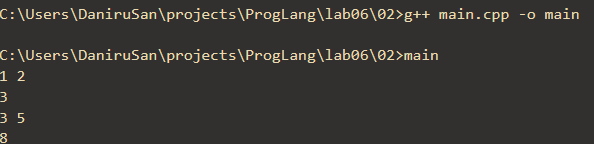
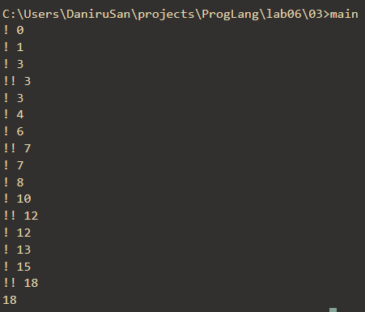
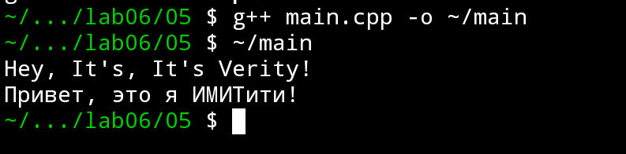
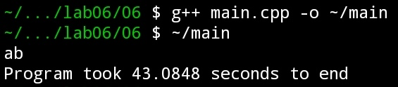
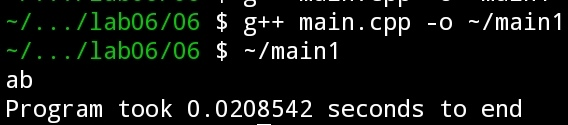
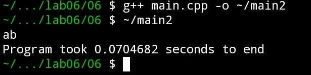
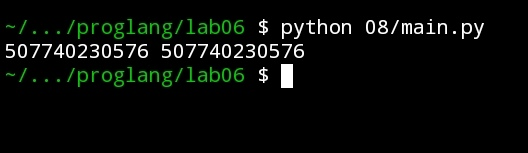
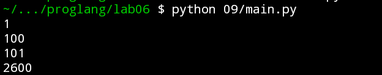

# Языки программирования
## Лабораторная работа 6

### Задание 1 **()** 
```
#include <iostream>
#include <cmath>
int main() {
   double x = 0;
   const auto Pi = std::acos(0) * 2;
   std::cout << Pi << std::endl;
   return 0;
}
```
*Проверьте четыре способа объявления* **Pi**.
* ```const auto Pi = acos(0) * 2;```
* ```constexpr auto Pi = std::acos(0) * 2;```
* ```const auto Pi = acos(x) * 2;```
* ```constexpr auto Pi = std::acos(x) * 2;```

*Что можно сказать об этих вариантах? Проверьте, в каких вариантах объявляется константа этапа трасляции.*

*Тексты программ разместите в папке с номером задания*


### Задание 2
```
#include <iostream>
int main() {
   {
      int x, y;
      std::cin >> x >> y;
      std::cout << x+y << std::endl;
   }
   {
      double x, y;
      std::cin >> x >> y;
      std::cout << x+y << std::endl;
   }
   return 0;
}
```
*Да, нужны*, так как здесь создаются переменные x и y два раза и чтобы они не конфликтовали необходимо использовать разные пространства имён.

Благодаря разным пространствам имён программа сработала как надо.\



### Задание 3
```
int s = 0;
for (int i = 0; i < 4; i++) {
   for (int i = 0; i < 3; i++) {
      s += i;
   } 
   s += i; 
}
std::cout << s;
```
*Ответ 18* был получен в результате вычисления во всех циклах. Это получилось потому что переменная s была инициализирована в функции main, поэтому все прибавления к этой переменной сохранились до финального вывода.

Я дописал этот код добавив вывод после каждого изменения переменной s для визуализации этого процесса.\


### Задание 4 
```
s = 0
for i in range(4):
   for i in range(3):
      s += i
   s += i
print(s)
```
*Ответ 20* такой потому что, в отличии от C++, Python не создаёт разные области видимости для переменной i, а просто перезаписывает эту переменную, в результате чего последняя строка во внешнем цикле всегда добавляет 2.

### Задание 5
Я написал программу которая создаёт 2 пространства имён с одной функцией в каждом. Я назвал эти функции одинаково, чтобы показать, что разные пространства имён используют свои функции. Затем добавил вывод этой функции для каждого пространства имён.\



### Задание 6
```
std::string a(100000, 'a');
std::string b(100000, 'b');
for (int i=0;i<1000000;i++) {
   std::string c(a);
   a = b;
   b = c;
}
std::cout << a[0] << b[0];
```
Я дописал в программу таймер, чтобы сразу получать время работы программы.

Изначально программа работала у меня 43 с лишним секунд.\


После замены всего внутри цикла на swap она стала работать меньше секунды.\


Чтобы исправить программу оставив всё как есть я использовал std::move, чтобы передавать между переменными не содержимое строк, а право владения существующей в памяти строкой. До этого программа создавал на каждой итерации новую строку, выделяла под это память, перемещала данные из одной области памяти в другую и всё это тратило время. Теперь программа работает меньше секунды, но дольше чем swap.\


### Задание 7
```
a = 'Hello world'
print(a, id(a))
b = a
print(b, id(b))
a += ' and goodbye'
print(a, id(a))
print(b, id(b))
```
Программа выводит строку и её id. Новая строка создалась на 1 строке. На 5 строке из-за неизменяемости строк в Python создаётся новый строковый объект уже с изменениями, поэтому у неё стал другой id. На 3 строке перменная b начинает ссылаться на ту же строку, поэтому id у строки a и b один, до того момента как переменная a не будет ссылаться на другой объект. Значение id означает уникальный идентификатр объекта на который ссылается переменная.

### Задание 8 
В работе двух способов присвоения строковых объектов разницы нет. Обе переменных указывают на одну строку и имеют одинаковый id.\


###  Задание 9 
Программа создаёт в цикле 2600 переменных используя с помощью функции globals(), затем записывает в эту перменную значение переменной value и увеличивает value на 1. Я вывел несколько перменных.\

