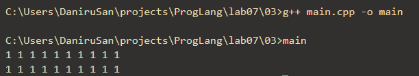
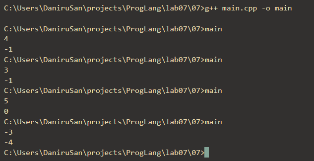

# Языки программирования
## Лабораторная работа 7

### Задание 1 **(2)**
*Оцените работу следующих фрагментов программ. Какие из них обладают неоднозначным поведением? Почему?*
```
int x=10, y=3;
std::cout << std::min(x=15, x+y);
```
```
int x=10, y=3;
x=15, y+=x, x+=y;
```
```
int x=10, y=9;
if (x>y++ && y++>9)
  cout << "yes" << endl;
cout << y;
```


### Задание 2 **(2)**
*Как записать следующие строки программы на С++ в виде одного
выражения? Приведите несколько способов, в том числе с использованием операторов инкремента.*
*Проверьте работу написанных программ*
```
x=x+1;
z=z+2*x+3*y;
y=y+1;
```
Можно записать это выражение:\
* Через запятую
* Используя суффикс и преффикс
* Использовать +=

### Задание 3 **(2)**
*Рассмотрите следующий фрагмент программы. Он заполняет вектор из 10 элементов единицами.*
```
std::vector<int> x(10);
for (int i = 0; i < 10;)
   x[i++] = 1;
```
*Перепишите ее так, чтобы в третьей строке использовался префиксный инкремент, но результат ее работы не изменился.*
```
std::vector<int> x(10);
for (...)
   x[++i]=1;
```
Я просто сменил границы цикла for, чтобы цикл был от -1 до 9. Это нужно, так как значение i сперва повышается на 1, а уже потом новое значение используется для заполнения списка.


### Задание 4 **(2)**

*Почему присваивание* ```(++x)=y``` *является синтаксически правильным, а*
```(x++)=y``` - *нет? Запишите текст сообщения об ошибке, переведите и объясните его.*


### Задание 5 **(2)**

*Программисты на Python для обмена значений двух переменных часто пишут строку*
```
a,b = b,a
```
*Проверьте, будет ли аналогичная строка на С++ (с точкой с запятой в конце) являться синтаксически
правильной? Будет ли она обменивать значения переменных? Как в языке С++ вычисляется это выражение?*


### Задание 6 **(2)**

*Проверьте работу следующего фрагмента программы*
```
  std::string s;
  for (int i=0; i<1000000; i++)
     s += 'a';
  std::cout << s.size();
```
*Измените третью строку на*
```
s=s+'a';
```
*Изменится ли что-нибудь в ее работе? Объясните результат.*


### Задание 7 **(2)**

*Как работает следующая программа? Как зависит результат от исходного значения?*
```
int x;
std::cin >> x;
x-->0 && x-->0 && x-->0 && x-->0 && x-->0;
std::cout << x;
```
Эта программа получает число x и затем сравнивает его с 0 попутно уменьшая его на 1.

Результат зависит от поярдка выполнения оппераций и от изначального числа.\
Если разбить на токены выражение с 3 строчки, то получится, что значение x сравнивается с 0, затем оно уменьшается на 1 и вновь сравнивается.\
Все эти сравнения будут идти слева направо, до тех пор, пока выражение не закончиться или не станет ложным.\
Таким образом, чтобы получить истину на 3 строке нужно число 5 или более. В остальных случаях будет -1, если число положительное и само число, если оно отрицательное.


### Задание 8 **(3)**

*Какое число выводит следующий фрагмент программы? Посчитайте результат без использования
вычислительной техники. Отчет должен содержать процесс вычислений.*
```
int s = 0;
for (int i = 0, j = 5;i+j <= 16;(i<j ? i : j)++)
   (s += i) += j;
std::cout << s;
```

###  Задание 9 **(3)**
*Рассмотрите следующую программу. Предполагается, что на вход подается некоторый
индекс в массиве - число от нуля до девяти и значение, которое надо записать по этому индексу.*
```
int i = 0;
std::vector<int> x(10);
std::cin >> i >> x[i];
std::cout << x[i];
```
*Проверьте работу этой программы на различных компиляторах. Найдите два компилятора (можно 
проверить онлайн компиляторы), на которых эта программа будет давать различные ответы при одинаковом
вводе. Как это объяснить?*
